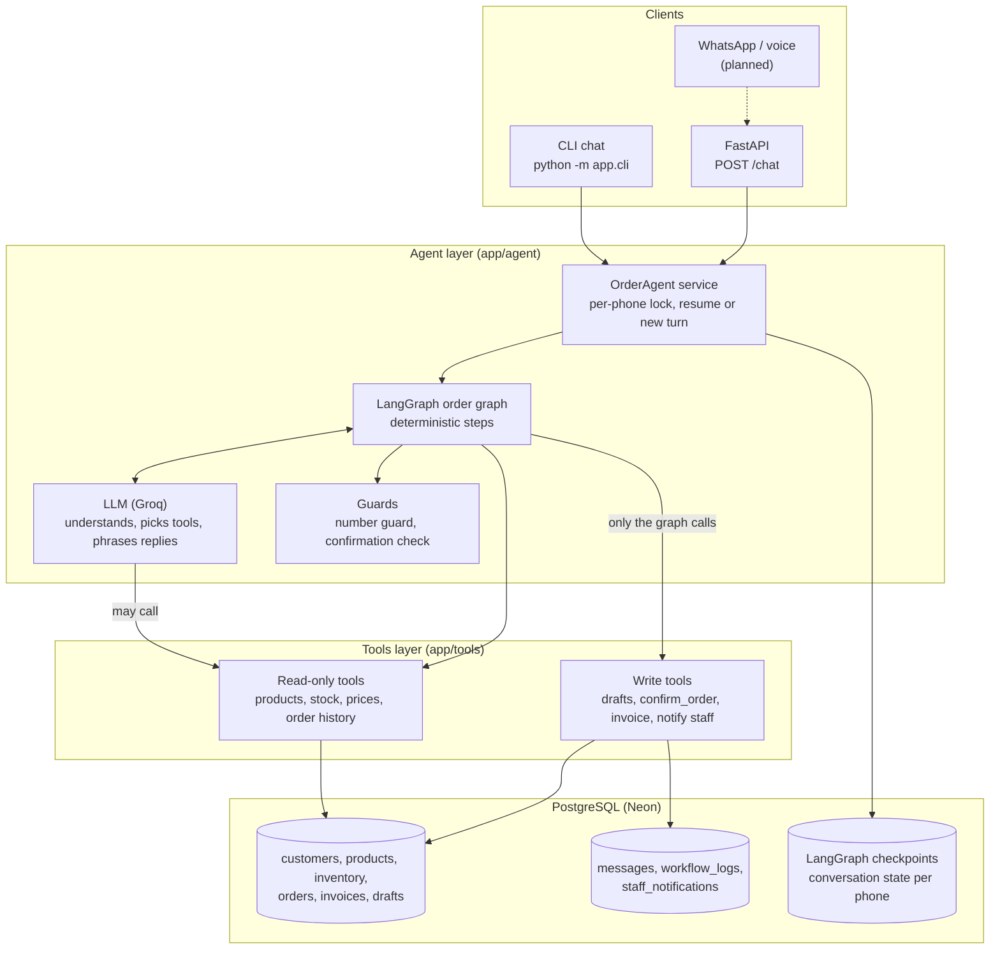
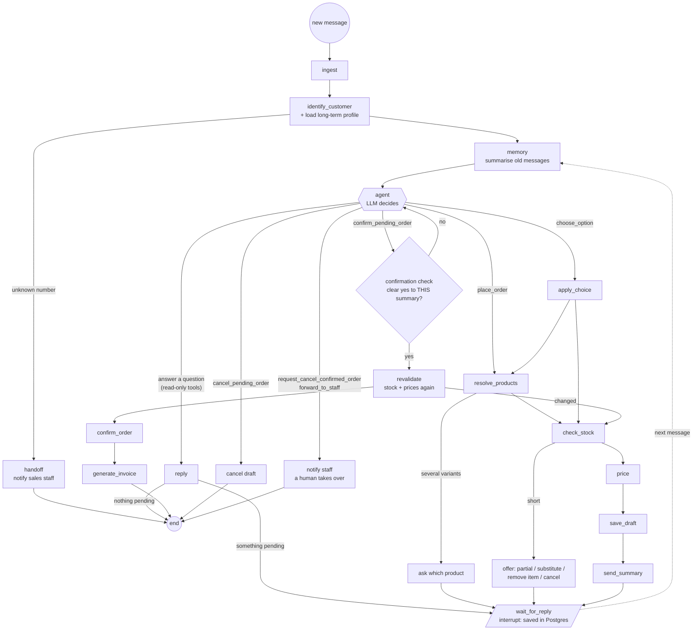
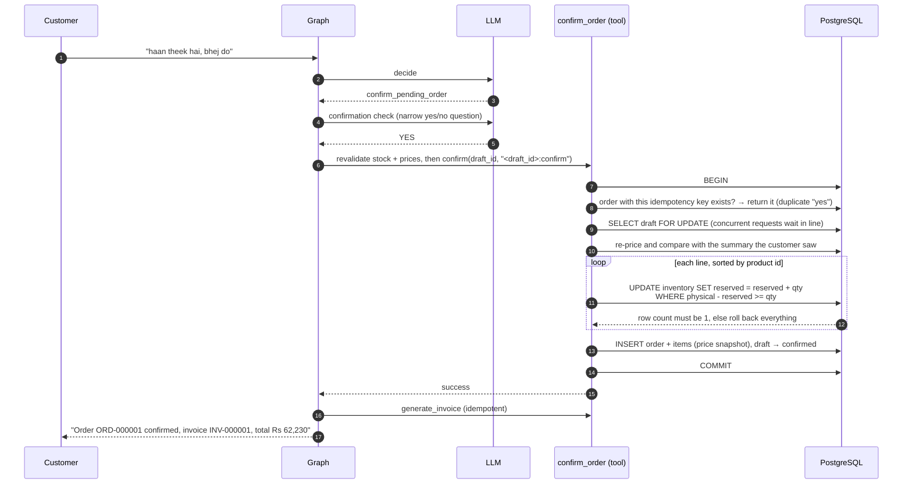
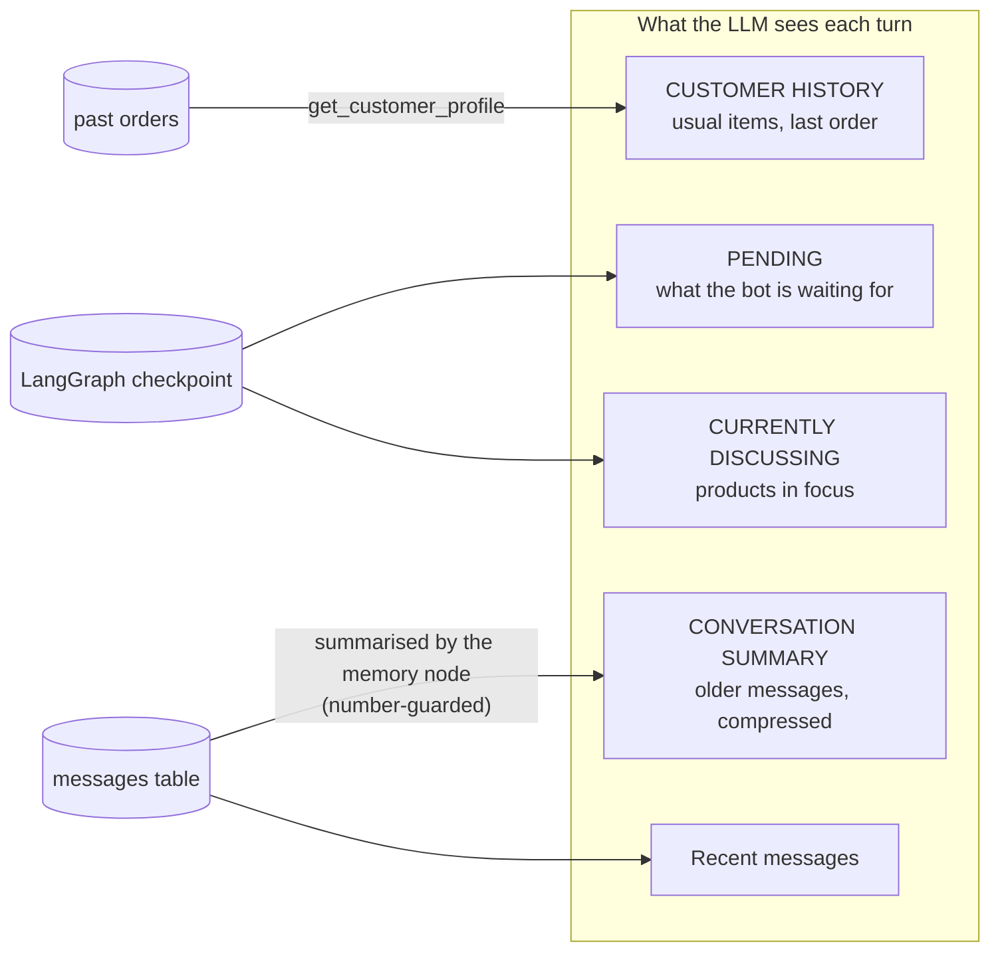
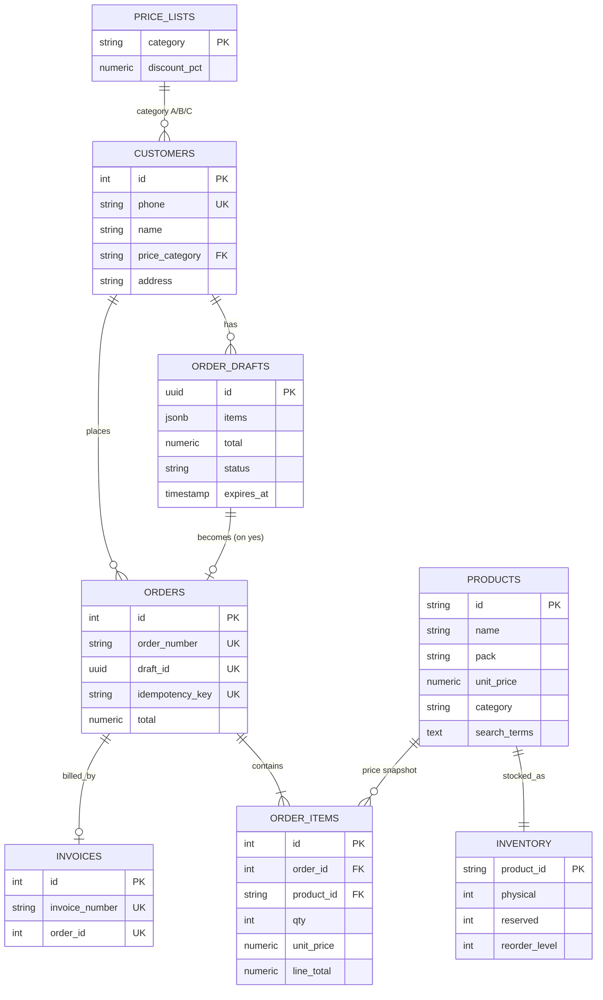

# BizFlow AI

An AI order agent for a wholesale FMCG / grocery distributor in Karachi.

Shopkeepers send order messages in **English, Urdu or Roman Urdu**. The agent identifies the shop by phone number,
finds the products, checks stock, prices the order with the shop's discount, and asks for confirmation. Only after
an explicit "yes" does it create the order, reserve stock and issue an invoice.

The interesting part is not that an LLM can chat. It's how the system stays **correct** when an LLM is involved:
the model never calculates money or stock, never writes to the database, and can't confirm an order on its own.

```
Customer: bhai 10 carton dalda aur 5 sooper bhej do
Bot:      Madina General Store, aap ka order:
          1. Dalda Cooking Oil 1L - 10 carton @ Rs 5,400 = Rs 54,000
          2. Sooper Classic biscuits - 5 carton @ Rs 1,900 = Rs 9,500
          Subtotal Rs 63,500, discount 2% (Rs 1,270), total Rs 62,230.
          Confirm karne ke liye 'haan' likhein. Yeh summary 2 ghante tak valid hai.
Customer: ek carton mein kitni bottles hoti hain?
Bot:      Ek carton mein 12 bottle hoti hain.
Customer: haan theek hai, bhej do
Bot:      Aap ka order confirm ho gaya. Order ORD-000001, invoice INV-000001, total Rs 62,230.
Customer: haan
Bot:      (nothing: a duplicate "yes" creates no second order and sends no second message)
```

**Status:** backend and agent orchestration are complete (CLI + REST API). No frontend yet.

---

## Contents

- [Architecture](#architecture)
- [The order graph](#the-order-graph)
- [How an order is confirmed safely](#how-an-order-is-confirmed-safely)
- [Memory](#memory)
- [Data model](#data-model)
- [Core rules](#core-rules)
- [Tech stack](#tech-stack)
- [Project layout](#project-layout)
- [Getting started](#getting-started)
- [API](#api)
- [Testing](#testing)
- [Design decisions](#design-decisions)
- [Limitations and roadmap](#limitations-and-roadmap)

---

## Architecture

Three layers, each with one job. **Only the tools layer touches the database.**



| Layer | Responsibility | Must never |
|---|---|---|
| **LLM** | Understand the message, choose a tool, write the reply text | calculate, touch the DB, confirm by itself |
| **Graph** (LangGraph) | Run the order process as fixed, testable steps; enforce guards | trust LLM output without checking |
| **Tools** | Plain Python functions with Pydantic input/output; all SQL lives here | depend on the LLM |
| **Database** | Constraints, row locks, unique idempotency keys: the last line of defence | allow negative or over-reserved stock |

---

## The order graph

Every message goes to the **agent** node first. There the LLM either answers a question using **read-only tools**,
or calls one **action tool**, which hands control to deterministic graph nodes that do the writes.
When the bot needs an answer from the customer, the graph **pauses** (`interrupt()`) and is saved in Postgres;
the next message resumes it, even hours later or after a server restart.



**Read-only tools the LLM may call:** `list_products`, `search_products`, `check_stock`, `suggest_alternatives`,
`get_prices`, `get_order_history`.
**Action tools** (the graph does the work): `place_order`, `choose_option`, `confirm_pending_order`,
`cancel_pending_order`, `request_cancel_confirmed_order`, `forward_to_staff`.

---

## How an order is confirmed safely

`confirm_order` runs in **one database transaction**. If any step fails, everything rolls back: no partial order,
no partial stock reservation.



A double "yes" is stopped at **three** independent levels:

1. **Per-phone advisory lock**: two messages from the same number are processed one at a time.
2. **Graph state**: a "yes" after a confirmed order re-calls `confirm_order`, gets `already_confirmed`, and stays silent.
3. **Database**: `orders.idempotency_key` is UNIQUE, so a second order is impossible.

---

## Memory

An LLM remembers nothing between calls. Everything it "knows" is assembled into the prompt on every turn:



| Memory | Solves | How |
|---|---|---|
| Conversation state | "What am I waiting for?" | LangGraph checkpointer in Postgres, `thread_id` = phone |
| Short-term history | "What was just said?" | latest messages since the last summary |
| Summary memory | Long chats without huge prompts | after 16 messages, the oldest are merged into a short summary (no prices; number-guarded) |
| Focus memory | "How many in **a carton**?" | products touched by recent tools are kept in state |
| Long-term profile | "Send my **usual order**" | computed in code from past orders (no LLM arithmetic) |

---

## Data model



Plus `messages` (transcript), `workflow_logs` (every LLM call, tool call, guard check and graph step, with timing)
and `staff_notifications`. Database constraints enforce `physical >= 0`, `reserved >= 0`, `reserved <= physical`,
`qty > 0` and `line_total = qty * unit_price`. Money is `NUMERIC(12,2)` / Python `Decimal`, never float.

---

## Core rules

1. **The LLM never calculates** prices, totals, discounts or stock. All numbers come from deterministic tools.
2. **Agents never touch the database directly.** All access goes through the tools.
3. **No order exists until the customer confirms.** Stock and prices are re-checked just before confirming.
4. **`confirm_order` is idempotent** (key `"<draft_id>:confirm"`). A duplicate "yes" creates nothing and sends nothing.
5. **Atomic stock reservation:** one guarded `UPDATE ... WHERE physical - reserved >= qty`, row count checked,
   in the same transaction as the order.
6. **Never report success until the tool result confirms it.**

How the rules are enforced around the LLM:

| Guard | What it stops |
|---|---|
| **Number guard** | Every number in a reply (and in the memory summary) must exist in tool data. An invented price is never sent. |
| **Confirmation check** | Before any order is confirmed, a second narrow LLM question asks whether the message really accepts *this* summary. "Create an order for 1 packet" is not a yes. |
| **Whole packs only** | Requests for loose packets or bottles are refused in code. |
| **Revalidation** | If stock or prices changed since the summary, the customer gets a new summary instead of an order. |
| **Business facts** | The LLM may only state listed policies; anything else (fees, delivery times) is forwarded to staff. |
| **Human hand-off** | Unknown numbers and requests to cancel a confirmed order go to staff, never handled automatically. |

---

## Tech stack

| Area | Choice |
|---|---|
| Language | Python 3.10 |
| Agent orchestration | LangGraph + `langgraph-checkpoint-postgres` |
| LLM | Groq (`openai/gpt-oss-120b`) via `langchain-groq`, behind a small interface so tests use a fake |
| API | FastAPI + Uvicorn |
| Database | PostgreSQL on Neon (separate Neon branch for tests) |
| ORM / migrations | SQLAlchemy 2.0, Alembic, psycopg 3 |
| Validation | Pydantic v2 |
| Tests | pytest |

---

## Project layout

```
backend/
  app/
    config.py            settings from .env
    phone.py             phone numbers → E.164 (+923001234567)
    db/                  models.py, session.py, seed.py
    tools/               base.py (tool wrapper, logging), catalog.py (read-only),
                         orders.py (drafts, confirm, invoice, history, profile), notify.py (staff, messages, lock)
    agent/               llm.py (tool specs, prompts, Groq), graph.py (the order graph),
                         text.py (formatting, number guard, backup replies), service.py (OrderAgent, checkpointer)
    api/main.py          FastAPI app
    cli.py               terminal chat
  migrations/            Alembic
  tests/                 tools/, scenarios/, api/
docs/LEARNING.md         the concepts behind the project, with reading links
CLAUDE.md                detailed engineering notes
```

---

## Getting started

**Requirements:** Python 3.10+, a [Neon](https://neon.com) Postgres project (plus a branch for tests), and a
[Groq](https://console.groq.com) API key.

```powershell
python -m venv .venv
.\.venv\Scripts\Activate.ps1
cd backend
pip install -r requirements.txt
copy .env.example .env        # then fill in the values below
```

`backend/.env`:

```
DATABASE_URL=postgresql://...neon.tech/neondb?sslmode=require        # main database
TEST_DATABASE_URL=postgresql://...neon.tech/neondb?sslmode=require   # a separate Neon branch for tests
GROQ_API_KEY=gsk_...
GROQ_MODEL=openai/gpt-oss-120b
```

Create the tables and load the demo data (4 shops, 8 products):

```powershell
alembic upgrade head
python -m app.db.seed
```

Chat in the terminal:

```powershell
python -m app.cli --phone "+92 300 1234567"
python -m app.cli --phone "+92 300 1234567" --test-db --seed-reset    # on the test branch with fresh data
```

Run the API (interactive docs at http://127.0.0.1:8000/docs):

```powershell
uvicorn app.api.main:app --reload
```

Demo customers: Ali Traders `+92 300 1234567` (2% discount), Bismillah Store `+92 321 5550192` (3%),
Karachi Mart `+92 345 2201876` (0%), Madina General Store `+92 312 4478210` (2%).

---

## API

| Method | Path | Description |
|---|---|---|
| `POST` | `/chat` | `{"phone", "message"}` → the bot's replies |
| `GET` | `/conversations/{phone}` | chat history and what the bot is waiting for |
| `GET` | `/health` | liveness check |

```json
POST /chat
{"phone": "+92 300 1234567", "message": "Send 10 cartons of Dalda oil and 5 cartons of Sooper biscuits"}

200 OK
{
  "thread_id": "+923001234567",
  "messages": ["Ali Traders, here is your order summary: ... Total: Rs 62,230 ..."],
  "waiting_for": "confirmation",
  "status": "active",
  "order_number": null,
  "invoice_number": null
}
```

An empty `messages` list means "send nothing" (for example a duplicate "yes"). Invalid input returns `422`;
a message from a number whose previous message is still being processed returns `409`.

---

## Testing

The tests run against a **separate Neon branch**, reset before each test. They never touch the main database.

```powershell
pytest                                   # everything (~15-20 min: every query is a network round trip)
pytest tests/tools -q                    # the tools, no LLM
pytest tests/scenarios -q                # end-to-end with a scripted fake LLM
pytest tests/api -q                      # the HTTP API
$env:RUN_LIVE_LLM="1"; pytest tests/scenarios/test_live.py   # optional: real Groq (costs tokens)
```

| Suite | What it proves |
|---|---|
| `tests/tools` | pricing and discounts, stock checks, atomic reservation, no overselling under concurrency, idempotent confirm and invoice, expiry, price-change detection |
| `tests/scenarios/test_acceptance.py` | the 6 acceptance scenarios end to end (English, Roman Urdu, ambiguous products, short stock, duplicate "yes", unknown number) |
| `tests/scenarios/test_safety.py` | what happens when the LLM is **wrong**: false confirmations, invented numbers, loose units, price changes, restarts |
| `tests/scenarios/test_memory.py` | focus memory, summary memory (incl. rejecting a summary with an invented number), "my usual order" |
| `tests/api` | the HTTP layer, input validation, simultaneous messages, the per-phone lock |

The scenario tests use a **scripted fake LLM**: each test says what the model decides ("for `yes`, call
`confirm_pending_order`"), and everything after that decision is real code on a real database. This tests the
system's guarantees deterministically, without tokens or flaky model output.

---

## Design decisions

- **The LLM decides, the graph writes.** Letting the model pick tools makes the bot flexible ("list my orders",
  "what's the price of 3 cartons of tapal?"), while keeping every write in fixed, tested code.
- **Guards instead of trust.** Prompts reduce mistakes; code catches them. Every guard result is logged.
- **Idempotency at the database level.** Retries, double taps and concurrent requests are expected, not exceptional.
- **Postgres for everything stateful.** Business data, conversation checkpoints, transcripts and locks all live in
  one database, so the app servers are stateless and a restart loses nothing.
- **Replies written from facts, templates as backup.** The LLM writes natural replies in the customer's language
  from pre-formatted facts ("Rs 5,400"); if the number guard rejects a reply, an English template is sent instead.

---

## Limitations and roadmap

**Known limitations**
- Each message makes 2–3 LLM calls plus several database round trips, so replies take a few seconds.
  Fine for chat; too slow for voice without optimisation.
- `/chat` has no authentication yet; it must not be exposed publicly as-is.
- The Groq free tier (200k tokens/day per model) is easy to exhaust while testing.

**Next**
- Authentication for the API.
- WhatsApp Business webhook and/or a phone channel (Vapi, as a custom LLM).
- Reorder alerts to the warehouse when stock falls below `reorder_level`.
- A job that expires stale drafts; a way for staff to resolve notifications.
- A staff dashboard (orders, stock, conversations, notifications).
- Deployment and CI.
