# BizFlow AI

**An AI order assistant for wholesale FMCG and grocery distributors.**
Shopkeepers message their orders the way they already do (in English, Urdu or Roman Urdu), and BizFlow AI turns
those messages into priced, stock-checked orders with invoices, collects payment, and keeps the warehouse,
accounts and suppliers in step.

```
Customer: bhai 10 carton dalda aur 5 sooper bhej do
Bot:      Madina General Store, aap ka order:
          1. Dalda Cooking Oil 1L - 10 carton @ Rs 5,400 = Rs 54,000
          2. Sooper Classic biscuits - 5 carton @ Rs 1,900 = Rs 9,500
          Subtotal Rs 63,500, discount 2% (Rs 1,270), total Rs 62,230.
          Confirm karne ke liye 'haan' likhein. Yeh summary 2 ghante tak valid hai.
Customer: ek carton mein kitni bottles hoti hain?
Bot:      Ek carton mein 12 bottle hoti hain.
Customer: haan theek hai, bhej do
Bot:      Order ORD-000001 place ho gaya, stock aap ke liye reserve hai. Rs 62,230 Meezan Bank ya
          JazzCash/Easypaisa par 24 ghante mein bhej kar transaction ID yahan bhej dein.
Customer: bhej diya, TID 784512
Bot:      Shukriya! Accounts team payment check kar rahi hai, confirm hote hi aap ko message aa jayega.
          ... (later, after the accountant checks the bank statement) ...
Bot:      Order ORD-000001 ki payment Rs 62,230 mil gayi hai. Aap ka order confirm ho gaya hai aur aaj
          (24 Nov) Liaquatabad No. 10 par deliver hoga. Shukriya!
Bot:      Aap ka order ORD-000001 aaj hamara rider Yasir (+923035550104) deliver karega.
Bot:      Aap ka order ORD-000001 rawana ho gaya hai, rider Yasir (+923035550104) aa raha hai.
Bot:      Order ORD-000001 deliver ho gaya hai. Shukriya!
```

---

## The problem

A distributor in Karachi serves hundreds of small shops. Orders arrive all day as informal messages:
*"bhai 10 carton dalda bhej do"*, *"20 bags rice"*, *"same as last time"*. Today a person has to:

- read and interpret each message (mixed languages, brand nicknames, typos)
- work out which product is meant ("rice": basmati, sella or broken?)
- check whether there is enough stock, and offer alternatives when there isn't
- apply each shop's discount and calculate the bill
- confirm with the shop, then enter the order, reserve the stock and issue an invoice
- chase the payment, match it against the bank statement, and only then release the goods
- pay suppliers the right amount, only for goods that actually arrived
- decide which rider takes which order, and keep the shop informed until the goods arrive

This is slow, error-prone and doesn't scale. A wrong total, a double-booked order or overselling stock costs
money and trust.

## The solution

BizFlow AI handles the whole conversation automatically, from the first message to the invoice. An AI model
understands the customer, but every price, total and stock figure comes from the business system, never from
the AI.

## What it does

| Capability | Example |
|---|---|
| **Understands natural orders** in English, Urdu and Roman Urdu | "bhai 10 carton dalda aur 5 sooper bhej do" |
| **Recognises customers** by phone number, with their own discount | Ali Traders gets 2%, Bismillah Store 3% |
| **Resolves ambiguous products** by asking | "20 bags rice" → "Basmati, Sella or Broken?" |
| **Checks live stock** and offers options when short | only 18 Nestle left → "18 only / 18 + 12 Aquafina / cancel" |
| **Prices orders exactly** with the customer's discount | subtotal, discount and total on every summary |
| **Asks before ordering**: nothing is booked until the customer says yes | the summary is valid for 2 hours |
| **Creates the order, reserves stock and issues an invoice** | ORD-000001, INV-000001 |
| **Re-checks prices and stock** right before confirming | a new summary if anything changed |
| **Ignores duplicate confirmations** | a second "yes" creates nothing and sends nothing |
| **Answers questions** about products, prices, stock and past orders | "list my orders", "price of 3 cartons of tapal?" |
| **Remembers context**: the product being discussed, long chats, usual orders | "how many in a carton?", "send my usual order" |
| **Replies in the customer's language** | Roman Urdu in, Roman Urdu out |
| **Hands over to staff** when a human is needed | unknown numbers, cancelling a confirmed order, policy questions |
| **Reorders from suppliers automatically** when stock falls to its reorder point | Nestle at 18 (reorder point 40) → purchase order for 62 cartons |
| **Picks the supplier** (preferred supplier, with fallbacks) | Metro Supply for water; Karachi Wholesale if Metro can't deliver |
| **Keeps a manager in the loop**: every purchase order needs approval | draft → approved → sent → received |
| **Offers backorders** when new stock is on its way | "18 now, the other 12 when stock arrives (about 1 day)" |
| **Tells customers when stock returns** | "when will Tapal be back?" |
| **Collects payment before dispatch** (online: bank transfer, JazzCash, Easypaisa) | pay within 24 hours, reference = order number |
| **An accountant verifies every payment** against the bank statement | the customer is messaged the moment it is verified, even if they left the chat |
| **Cancels unpaid orders** after 24 hours and frees the reserved stock | reported payments are never cancelled while accounts is busy |
| **Schedules delivery** | paid before 2 PM: delivered the same day; otherwise the next day |
| **Pays suppliers safely**: invoice checked against what was ordered and received | billed for 62 cartons, received 60 → flagged |
| **Assigns riders automatically**: same area first, then whoever has delivered least today | Ali Traders (Saddar) → Imran, the Saddar rider |
| **Never overloads a rider** (3 deliveries at a time) and queues the rest | the 4th order waits and goes to the first rider who finishes |
| **Keeps the shop informed** at every step | rider assigned (name, phone) → on the way → delivered |
| **Retries failed deliveries** once the next day, then returns the goods | shop closed twice → back to the warehouse, refund arranged |
| **Logs everything** | every AI decision, tool call and safety check, with timing |

## What it guarantees

- **No invented numbers:** prices, discounts, totals and stock always come from the database.
- **No order without consent:** an order exists only after a clear "yes" to that exact summary.
- **No overselling:** stock is reserved atomically, even when several shops confirm at the same moment.
- **No double orders:** repeated or simultaneous confirmations produce exactly one order.
- **No silent failures:** success is reported only after the order and invoice really exist.
- **No dispatch without verified payment:** a person checks every payment; the amount always comes from the order.
- **Stock is exact:** reserved when the customer says yes, removed from the warehouse only when the rider delivers,
  released if the order is cancelled or returned.
- **No paying twice or for missing goods:** supplier invoices are matched against receipts, and recording,
  approving and paying are done by three different people.

---

## Architecture

The AI understands and talks; the business system decides and records.

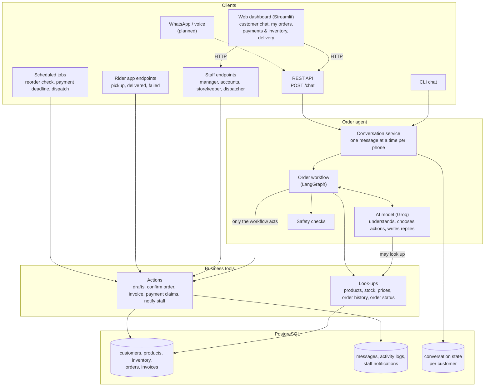

---

## Dashboard

A web dashboard (Streamlit) that talks to the API over HTTP, exactly like a real WhatsApp or back-office client
would:

| Page | Who it's for | What it shows |
|---|---|---|
| **Chat with the bot** | a shopkeeper | the conversation, and next to it *what the server did* for the last message: every AI decision, tool call (with input and output), safety check and timing |
| **My orders** | a shopkeeper | their details, every order with items, payment status, delivery date and rider |
| **Payments & inventory** | accounts and the manager | payments to verify, stock (physical, reserved, available, on order, reorder warnings), purchase orders, supplier bills, staff notifications |
| **Delivery** | the dispatcher and riders | riders and their load, dispatch, and a simulated rider app (picked up / delivered / could not deliver) |

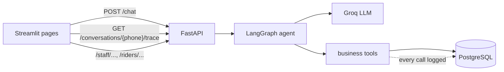

---

## Order workflow

Every message first goes to the AI, which either answers a question or chooses an action. Actions run as fixed
business steps. When the assistant needs an answer from the customer, the conversation is saved and resumes with
the next message, even hours later.

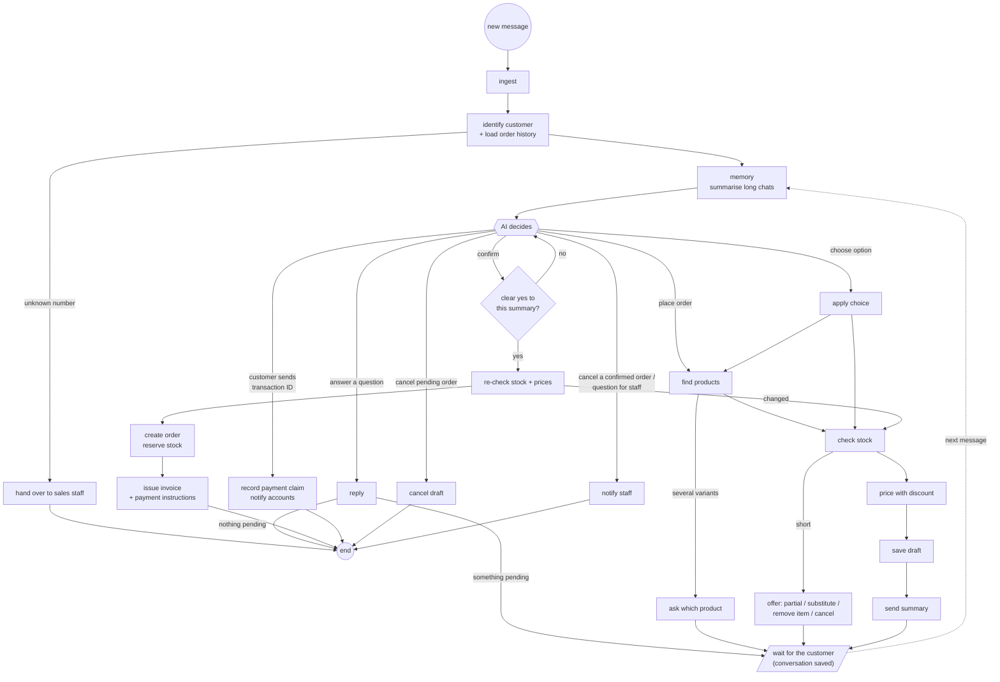

---

## Confirming an order

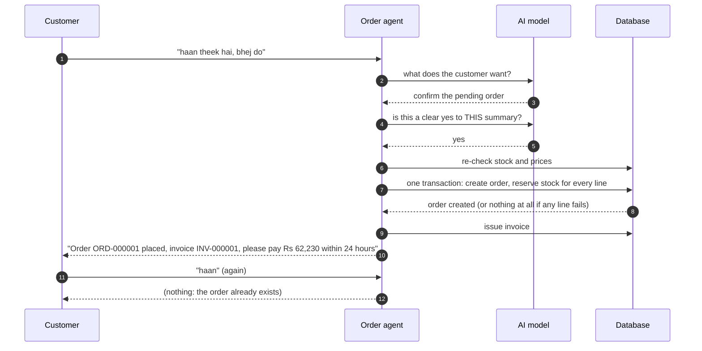

---

## Restocking from suppliers

After every confirmed order, and once a day, BizFlow AI checks each product's stock against its reorder point and
drafts purchase orders from the preferred supplier. A manager approves every purchase order; stock goes up only
when the goods are actually received.

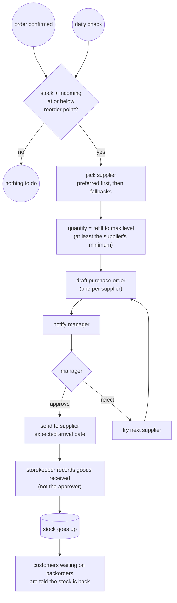

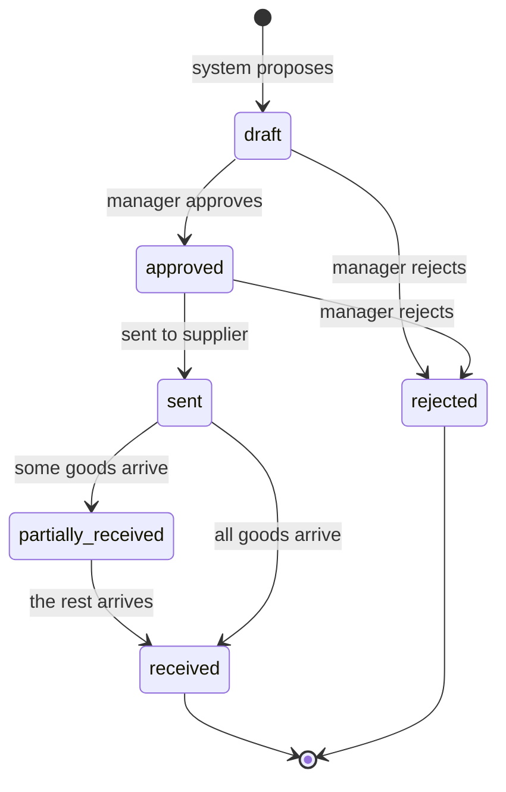

---

## Getting paid

Payment is online and in advance. The bot never decides that money has arrived: a person in accounts checks the
bank statement. Because that can take hours, the customer doesn't have to stay in the chat; the system messages
them as soon as the payment is verified.

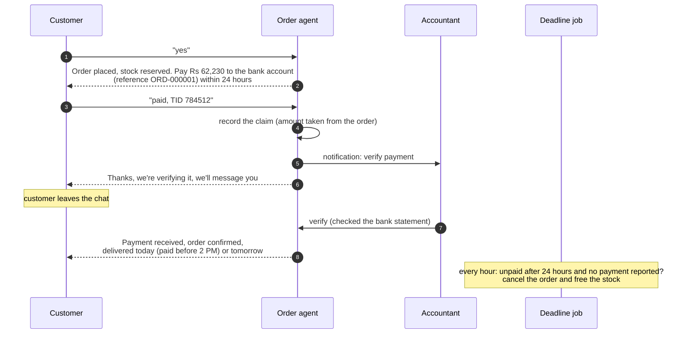

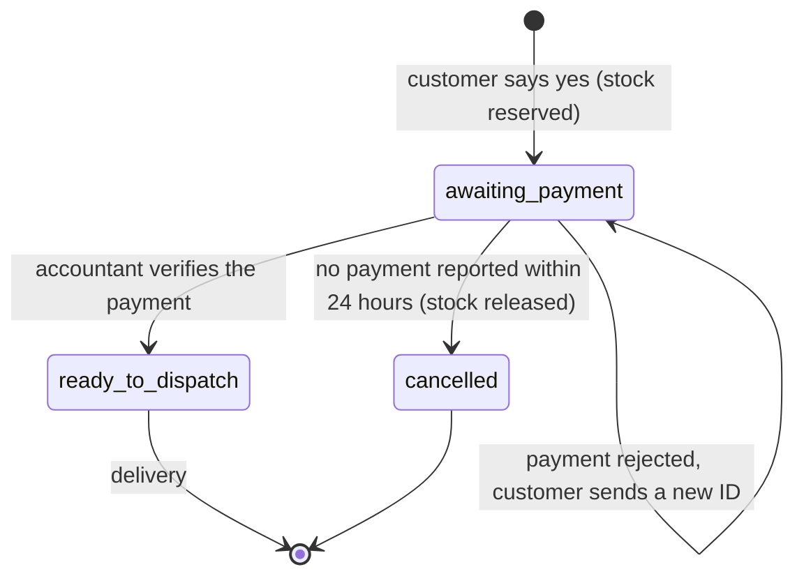

## Delivering

Once a payment is verified, the order is queued for its delivery day: today if paid before 2 PM, otherwise
tomorrow. On that day each order goes to a rider, and the shop hears about every step.

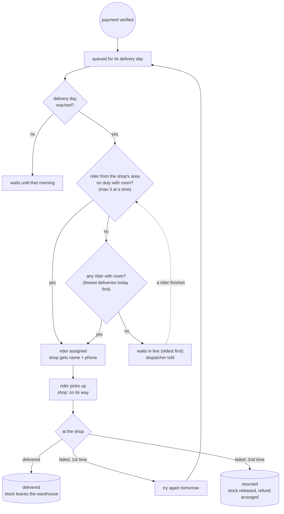

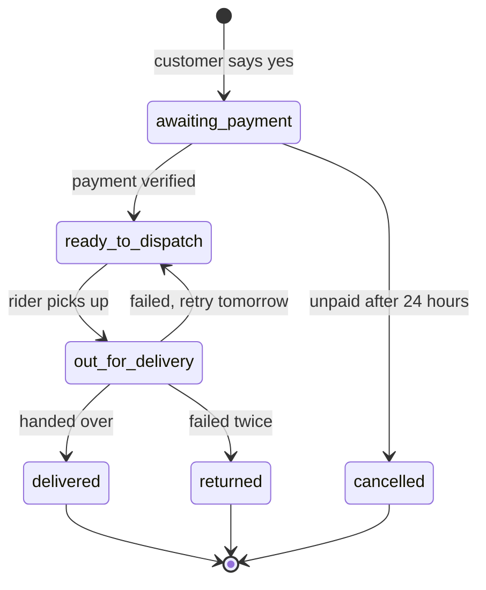

## Paying suppliers

A supplier is paid only for what we ordered **and** received, and only after a manager approves.

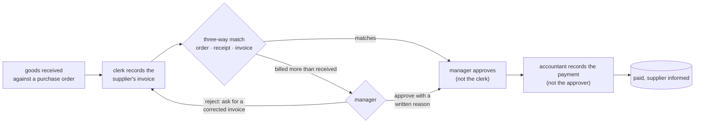

Each supplier has payment terms (e.g. 15 days), so every invoice has a due date and overdue bills stand out.

---

## Memory

The assistant keeps track of the conversation at several levels, so customers can talk naturally.

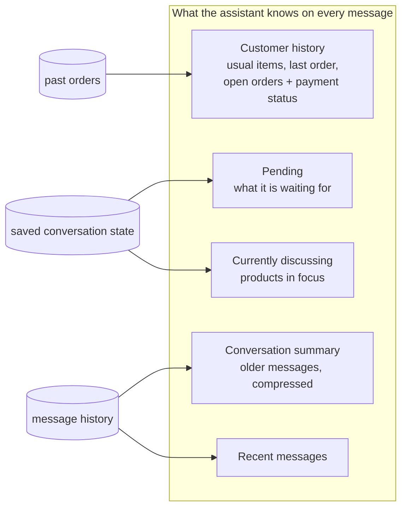

| Memory | Lets the customer say |
|---|---|
| Pending action | "yes", "2", "no" |
| Products in focus | "how many bottles in **a carton**?" |
| Conversation summary | long chats without losing earlier details |
| Customer history | "send my **usual order**" |

---

## Data model

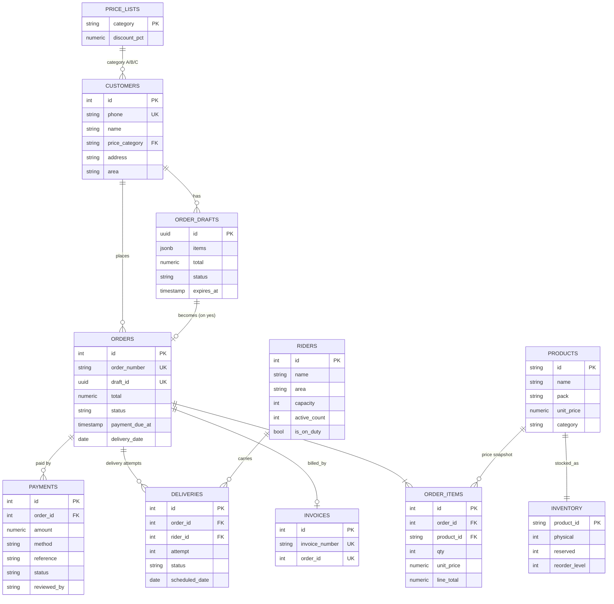

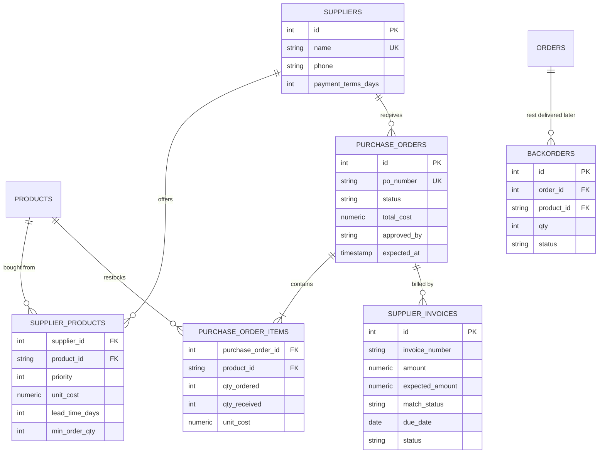

Also stored: the full message history, an activity log of every AI decision and business action, and
notifications for staff.

---

## Tech stack

| Area | Technology |
|---|---|
| Language | Python |
| Agent workflow | LangGraph (with conversation state saved in PostgreSQL) |
| AI model | Groq (`openai/gpt-oss-120b`) via LangChain |
| API | FastAPI |
| Database | PostgreSQL on Neon, SQLAlchemy 2.0, Alembic |
| Validation | Pydantic |
| Dashboard | Streamlit (calls the API over HTTP) |

---

## Getting started

**Requirements:** Python 3.10+, a [Neon](https://neon.com) Postgres database and a [Groq](https://console.groq.com) API key.

```powershell
python -m venv .venv
.\.venv\Scripts\Activate.ps1
cd backend
pip install -r requirements.txt
copy .env.example .env        # add DATABASE_URL and GROQ_API_KEY
alembic upgrade head          # create the tables
python -m app.db.seed         # demo shops and products
```

Chat in the terminal:

```powershell
python -m app.cli --phone "+92 300 1234567"
```

Or run the API (interactive docs at http://127.0.0.1:8000/docs):

```powershell
uvicorn app.api.main:app --reload
```

And the dashboard, in a second terminal from the repository root (opens http://localhost:8501):

```powershell
.\.venv\Scripts\Activate.ps1
pip install -r dashboard/requirements.txt
streamlit run dashboard/app.py
```

**Demo shops:** Ali Traders `+92 300 1234567` (2% discount), Bismillah Store `+92 321 5550192` (3%),
Karachi Mart `+92 345 2201876` (no discount), Madina General Store `+92 312 4478210` (2%).
**Demo riders:** Imran (Saddar), Kashif (Gulshan), Naveed (Tariq Road), Yasir (Liaquatabad), 3 deliveries at a time.
**Demo products:** Dalda oil, Sooper biscuits, three kinds of rice, Nestle and Aquafina water, Tapal tea.

---

## API

| Method | Path | Description |
|---|---|---|
| `POST` | `/chat` | send a customer message, get the assistant's replies |
| `GET` | `/conversations/{phone}` | a customer's chat history and what the assistant is waiting for |
| `GET` | `/health` | service status |
| `GET` | `/conversations/{phone}/trace?run_id=` | what the server did for one message: AI calls, tool calls, safety checks |
| `GET` | `/customers/{phone}` | a shop's details and orders (payment, delivery, rider) |
| `GET` | `/staff/inventory` | stock per product: physical, reserved, available, on order, reorder flag |
| `GET` / `POST` | `/staff/notifications` · `/{id}/resolve` | staff notifications |
| `POST` | `/staff/reorder-check` | check all products now and draft purchase orders |
| `GET` | `/staff/purchase-orders?status=draft` | purchase orders, optionally by status |
| `POST` | `/staff/purchase-orders/{po}/approve` · `/reject` · `/send` · `/receive` | the manager and storekeeper steps |
| `GET` | `/staff/payments?status=pending_verification` | customer payments waiting for an accountant |
| `POST` | `/staff/payments/{payment}/verify` · `/reject` | the accountant's decision (the customer is messaged); `{payment}` = payment number, order number or the customer's transaction ID |
| `POST` | `/staff/payments/cancel-unpaid` | run the 24-hour payment deadline now |
| `GET` / `POST` | `/staff/supplier-invoices` | list supplier bills (due, overdue) / record a supplier's invoice |
| `POST` | `/staff/supplier-invoices/{id}/approve` · `/reject` · `/pay` | manager approval and recording the payment |
| `POST` | `/staff/dispatch` | assign today's waiting deliveries to riders now |
| `GET` | `/staff/deliveries` · `/staff/riders` | deliveries by status or date; riders with today's load |
| `GET` | `/riders/{rider}/deliveries` | a rider's current jobs (for a rider app) |
| `POST` | `/riders/{rider}/deliveries/{id}/pickup` · `/delivered` · `/failed` | the rider's steps |
| `POST` | `/riders/{rider}/duty` | start or end a shift |

Scheduled jobs: `python -m app.jobs reorder-check` (daily), `python -m app.jobs payment-deadline` (hourly) and
`python -m app.jobs dispatch` (every morning, then every 15 minutes).

```json
POST /chat
{"phone": "+92 300 1234567", "message": "Send 10 cartons of Dalda oil and 5 cartons of Sooper biscuits"}

{
  "thread_id": "+923001234567",
  "messages": ["Ali Traders, here is your order summary: ... Total: Rs 62,230 ..."],
  "waiting_for": "confirmation",
  "status": "active",
  "order_number": null,
  "invoice_number": null,
  "run_id": "3f9c1a2b7d4e"
}
```

---

## Roadmap

- WhatsApp Business integration
- Phone orders by voice (Vapi)
- Proof of delivery (a code the shop gives the rider) and live rider location
- Payment gateway (automatic verification), cash on delivery and credit limits
- Reports: daily sales, top products, slow payers, rider performance
- Deployment
