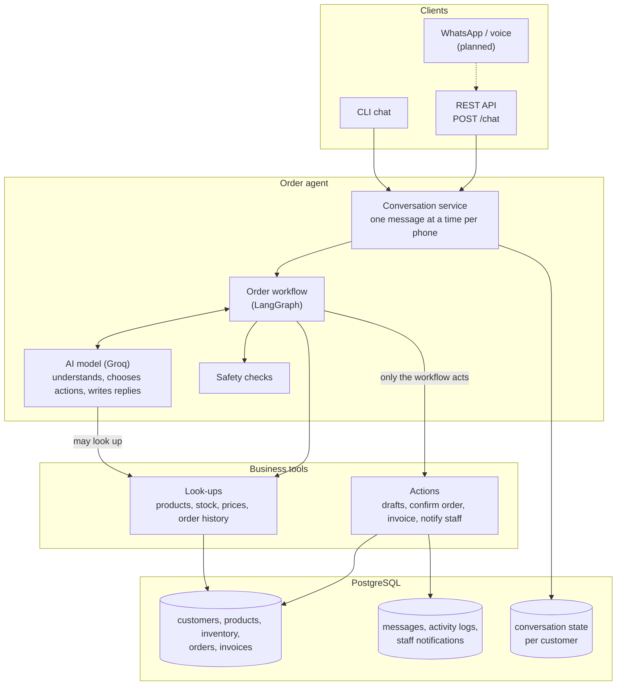
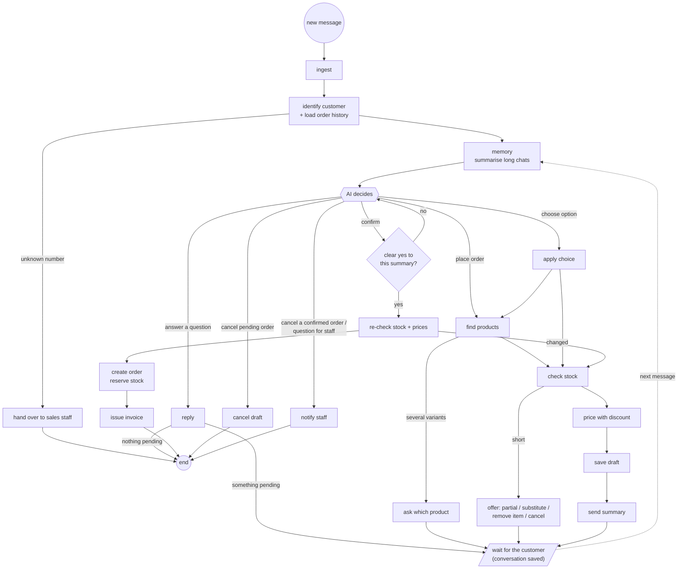
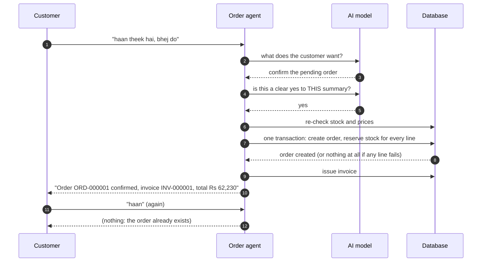
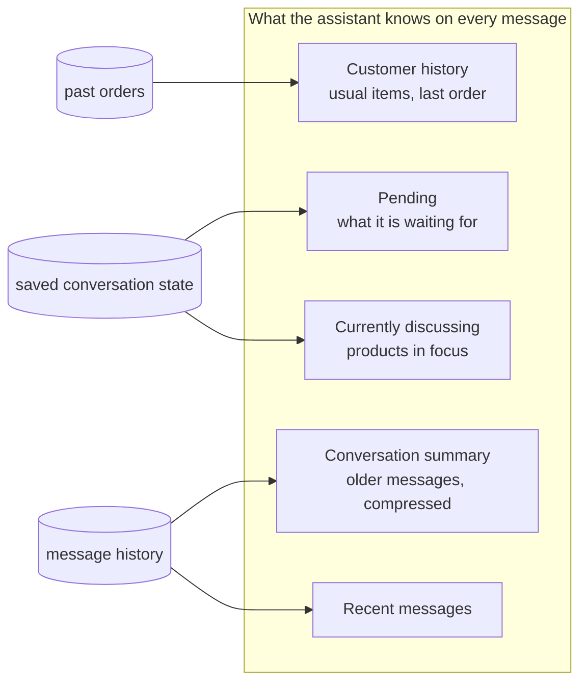
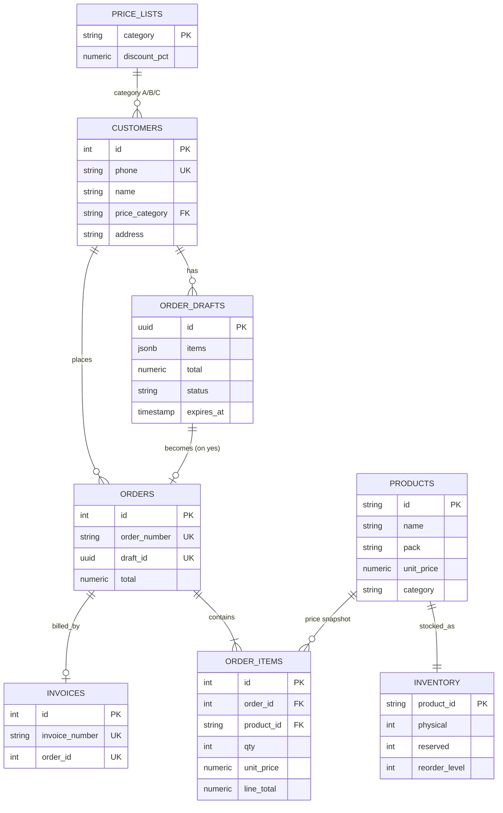

# BizFlow AI

**An AI order assistant for wholesale FMCG and grocery distributors.**
Shopkeepers message their orders the way they already do (in English, Urdu or Roman Urdu), and BizFlow AI turns
those messages into confirmed, priced, stock-checked orders with invoices.

```
Customer: bhai 10 carton dalda aur 5 sooper bhej do
Bot:      Madina General Store, aap ka order:
          1. Dalda Cooking Oil 1L - 10 carton @ Rs 5,400 = Rs 54,000
          2. Sooper Classic biscuits - 5 carton @ Rs 1,900 = Rs 9,500
          Subtotal Rs 63,500, discount 2% (Rs 1,270), total Rs 62,230.
          Confirm karne ke liye 'haan' likhein. Yeh summary 2 ghante tak valid hai.
Customer: ek carton mein kitni bottles hoti hain?
Bot:      Ek carton mein 12 bottle hoti hain.
Customer: haan theek hai, bhej do
Bot:      Aap ka order confirm ho gaya. Order ORD-000001, invoice INV-000001, total Rs 62,230.
```

---

## The problem

A distributor in Karachi serves hundreds of small shops. Orders arrive all day as informal messages:
*"bhai 10 carton dalda bhej do"*, *"20 bags rice"*, *"same as last time"*. Today a person has to:

- read and interpret each message (mixed languages, brand nicknames, typos)
- work out which product is meant ("rice": basmati, sella or broken?)
- check whether there is enough stock, and offer alternatives when there isn't
- apply each shop's discount and calculate the bill
- confirm with the shop, then enter the order, reserve the stock and issue an invoice

This is slow, error-prone and doesn't scale. A wrong total, a double-booked order or overselling stock costs
money and trust.

## The solution

BizFlow AI handles the whole conversation automatically, from the first message to the invoice. An AI model
understands the customer, but every price, total and stock figure comes from the business system, never from
the AI.

## What it does

| Capability | Example |
|---|---|
| **Understands natural orders** in English, Urdu and Roman Urdu | "bhai 10 carton dalda aur 5 sooper bhej do" |
| **Recognises customers** by phone number, with their own discount | Ali Traders gets 2%, Bismillah Store 3% |
| **Resolves ambiguous products** by asking | "20 bags rice" → "Basmati, Sella or Broken?" |
| **Checks live stock** and offers options when short | only 18 Nestle left → "18 only / 18 + 12 Aquafina / cancel" |
| **Prices orders exactly** with the customer's discount | subtotal, discount and total on every summary |
| **Asks before ordering**: nothing is booked until the customer says yes | the summary is valid for 2 hours |
| **Creates the order, reserves stock and issues an invoice** | ORD-000001, INV-000001 |
| **Re-checks prices and stock** right before confirming | a new summary if anything changed |
| **Ignores duplicate confirmations** | a second "yes" creates nothing and sends nothing |
| **Answers questions** about products, prices, stock and past orders | "list my orders", "price of 3 cartons of tapal?" |
| **Remembers context**: the product being discussed, long chats, usual orders | "how many in a carton?", "send my usual order" |
| **Replies in the customer's language** | Roman Urdu in, Roman Urdu out |
| **Hands over to staff** when a human is needed | unknown numbers, cancelling a confirmed order, policy questions |
| **Logs everything** | every AI decision, tool call and safety check, with timing |

## What it guarantees

- **No invented numbers:** prices, discounts, totals and stock always come from the database.
- **No order without consent:** an order exists only after a clear "yes" to that exact summary.
- **No overselling:** stock is reserved atomically, even when several shops confirm at the same moment.
- **No double orders:** repeated or simultaneous confirmations produce exactly one order.
- **No silent failures:** success is reported only after the order and invoice really exist.

---

## Architecture

The AI understands and talks; the business system decides and records.



---

## Order workflow

Every message first goes to the AI, which either answers a question or chooses an action. Actions run as fixed
business steps. When the assistant needs an answer from the customer, the conversation is saved and resumes with
the next message, even hours later.



---

## Confirming an order



---

## Memory

The assistant keeps track of the conversation at several levels, so customers can talk naturally.



| Memory | Lets the customer say |
|---|---|
| Pending action | "yes", "2", "no" |
| Products in focus | "how many bottles in **a carton**?" |
| Conversation summary | long chats without losing earlier details |
| Customer history | "send my **usual order**" |

---

## Data model



Also stored: the full message history, an activity log of every AI decision and business action, and
notifications for staff.

---

## Tech stack

| Area | Technology |
|---|---|
| Language | Python |
| Agent workflow | LangGraph (with conversation state saved in PostgreSQL) |
| AI model | Groq (`openai/gpt-oss-120b`) via LangChain |
| API | FastAPI |
| Database | PostgreSQL on Neon, SQLAlchemy 2.0, Alembic |
| Validation | Pydantic |

---

## Getting started

**Requirements:** Python 3.10+, a [Neon](https://neon.com) Postgres database and a [Groq](https://console.groq.com) API key.

```powershell
python -m venv .venv
.\.venv\Scripts\Activate.ps1
cd backend
pip install -r requirements.txt
copy .env.example .env        # add DATABASE_URL and GROQ_API_KEY
alembic upgrade head          # create the tables
python -m app.db.seed         # demo shops and products
```

Chat in the terminal:

```powershell
python -m app.cli --phone "+92 300 1234567"
```

Or run the API (interactive docs at http://127.0.0.1:8000/docs):

```powershell
uvicorn app.api.main:app --reload
```

**Demo shops:** Ali Traders `+92 300 1234567` (2% discount), Bismillah Store `+92 321 5550192` (3%),
Karachi Mart `+92 345 2201876` (no discount), Madina General Store `+92 312 4478210` (2%).
**Demo products:** Dalda oil, Sooper biscuits, three kinds of rice, Nestle and Aquafina water, Tapal tea.

---

## API

| Method | Path | Description |
|---|---|---|
| `POST` | `/chat` | send a customer message, get the assistant's replies |
| `GET` | `/conversations/{phone}` | a customer's chat history and what the assistant is waiting for |
| `GET` | `/health` | service status |

```json
POST /chat
{"phone": "+92 300 1234567", "message": "Send 10 cartons of Dalda oil and 5 cartons of Sooper biscuits"}

{
  "thread_id": "+923001234567",
  "messages": ["Ali Traders, here is your order summary: ... Total: Rs 62,230 ..."],
  "waiting_for": "confirmation",
  "status": "active",
  "order_number": null,
  "invoice_number": null
}
```

---

## Roadmap

- WhatsApp Business integration
- Phone orders by voice (Vapi)
- Low-stock alerts to the warehouse
- Staff dashboard: orders, stock, conversations, notifications
- Deployment
